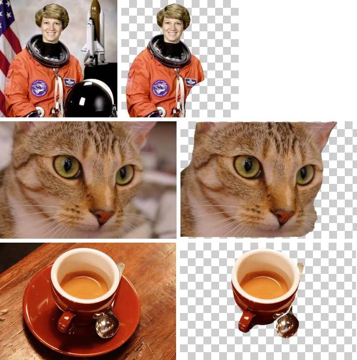

# 🖼️ Background Remover

[](https://github.com/murapadev/background-remover/actions/workflows/ci.yml)
[](https://opensource.org/licenses/MIT)


> Script de Python que quita el fondo a todas las imágenes de una carpeta con un modelo de
> Hugging Face y guarda PNG con transparencia.



*Salida real de `background_remover.py` con el modelo por defecto (a la derecha, la
transparencia se ve como un tablero). La taza se procesó con
`--ignore-labels "dining table,diningtable"`. Imágenes de dominio público / CC0 incluidas
en scikit-image (NASA, Stéfan van der Walt, Rachel Michetti).*

---

## 📋 Tabla de contenidos

- [Características](#-características)
- [Instalación](#-instalación)
- [Uso](#-uso)
- [Modelo y licencias](#-modelo-y-licencias)
- [Desarrollo](#-desarrollo)
- [Licencia](#-licencia)

## ✨ Características

- 🤖 **Modelos de Hugging Face**: por defecto uno MIT que no ejecuta código remoto
- 📁 **Por lotes**: procesa una carpeta entera, con `--recursive` también las subcarpetas
- 🖼️ **Formatos**: JPG, PNG, BMP, TIFF y WebP de entrada; PNG RGBA de salida
- 🛡️ **Robusto**: una imagen rota no detiene el lote; al final se listan los fallos
- ⚡ **GPU automática**: usa CUDA o Apple MPS si están disponibles, si no, CPU

## 🛠️ Instalación

Requiere Python 3.10 o superior.

```bash
git clone https://github.com/murapadev/background-remover.git
cd background-remover
python -m venv .venv
source .venv/bin/activate        # Windows: .venv\Scripts\activate
pip install -r requirements.txt
```

`pip` instala el `torch` por defecto de tu plataforma. Para GPU NVIDIA instala antes la
build de CUDA adecuada desde [pytorch.org](https://pytorch.org/get-started/locally/). La
primera ejecución descarga el modelo (~1,3 GB) a la caché de Hugging Face.

## 🚀 Uso

```bash
# Carpeta ./input -> ./output (valores por defecto)
python background_remover.py

# Carpetas propias, incluyendo subcarpetas (se replica el árbol en la salida)
python background_remover.py -i ./fotos -o ./recortes --recursive

# Solo ciertos formatos, forzando CPU
python background_remover.py -i ./fotos -f jpg,png --device cpu

# Quedarse solo con personas, o descartar la mesa
python background_remover.py -i ./fotos --labels person
python background_remover.py -i ./fotos --ignore-labels "dining table,diningtable"
```

Cada `foto.jpg` se guarda como `foto_no_bg.png`. Salida de ejemplo:

```text
Loading tue-mps/coco_instance_eomt_large_640 on cpu...
[1/3] astronaut.jpg
  -> output/astronaut_no_bg.png
[2/3] broken.jpg
  error: UnidentifiedImageError: cannot identify image file 'input/broken.jpg'
[3/3] sub/chelsea.jpg
  -> output/sub/chelsea_no_bg.png

Done: 2/3 images processed.
  failed: input/broken.jpg (UnidentifiedImageError: cannot identify image file 'input/broken.jpg')
```

| Opción | Descripción |
|--------|-------------|
| `-i`, `--input` | Carpeta de entrada (por defecto `input`) |
| `-o`, `--output` | Carpeta de salida (por defecto `output`); si está dentro de la entrada, se ignora al buscar imágenes |
| `-m`, `--model` | Id del modelo en Hugging Face |
| `--revision` | Rama, tag o commit del modelo. El modelo por defecto va fijado a un commit verificado |
| `-r`, `--recursive` | Procesa también subcarpetas |
| `-f`, `--formats` | Extensiones separadas por comas (por defecto `jpg,jpeg,png,bmp,tif,tiff,webp`) |
| `--device` | `auto` (por defecto), `cpu`, `cuda` o `mps` |
| `--labels` | Conserva solo estas clases (p. ej. `person,cat`) |
| `--ignore-labels` | Descarta estas clases (p. ej. `dining table`) |
| `--trust-remote-code` | Permite modelos que ejecutan su propio código Python (RMBG). Úsalo solo con repos de confianza |

Códigos de salida: `0` todo bien, `1` alguna imagen falló, `2` entrada inválida o el
modelo no se pudo cargar.

### Cómo funciona y limitaciones

El modelo por defecto es de **segmentación de instancias** entrenado en COCO: detecta
objetos de 80 clases (personas, animales, vehículos, tazas, muebles...) y el script une
sus máscaras como canal alfa. Por eso:

- Lo que no sea una clase de COCO desaparece (el plato de la taza del ejemplo).
- Los bordes son más duros que los de un modelo de matting dedicado (pelo, pelusa).
- Si no detecta nada, la imagen cuenta como fallo (`NoForegroundError`) en vez de
  guardarse vacía.

Para recortes de producto o retrato con bordes finos, RMBG-1.4 da mejor resultado,
pero mira antes su licencia (abajo):

```bash
pip install scikit-image   # dependencia del código de RMBG-1.4
python background_remover.py -m briaai/RMBG-1.4 \
    --revision 2ceba5a5efaec153162aedea169f76caf9b46cf8 --trust-remote-code
```

Con GPUs antiguas (p. ej. Pascal, GTX 10xx) las builds recientes de PyTorch para CUDA
ya no incluyen sus kernels; el script lo detecta y usa la CPU avisando.

## 📜 Modelo y licencias

El código de este repo es MIT, pero **cada modelo tiene su propia licencia**, que es la que
debes respetar al usarlo.

| Modelo | Licencia | ¿Uso comercial? | ¿Ejecuta código del repo del modelo? |
|--------|----------|-----------------|--------------------------------------|
| [`tue-mps/coco_instance_eomt_large_640`](https://huggingface.co/tue-mps/coco_instance_eomt_large_640) (**por defecto**) | MIT | Sí | No (arquitectura nativa de `transformers`) |
| [`briaai/RMBG-1.4`](https://huggingface.co/briaai/RMBG-1.4) | [bria-rmbg-1.4](https://bria.ai/bria-huggingface-model-license-agreement/) | **No** (licencia comercial de pago) | Sí (`--trust-remote-code`) |
| [`briaai/RMBG-2.0`](https://huggingface.co/briaai/RMBG-2.0) | [CC BY-NC 4.0](https://creativecommons.org/licenses/by-nc/4.0/) | **No** | Sí, y además es un repo restringido (gated) |

- El modelo por defecto es MIT y se descarga fijado a un commit concreto
  (`a43666870d47a7010bfea2c4554f7ca829714558`). Está entrenado sobre COCO (anotaciones
  CC BY 4.0) con un backbone DINOv2 (Apache 2.0).
- Las versiones anteriores de este script usaban RMBG-2.0/1.4 por defecto: **no son
  aptas para uso comercial** y necesitan ejecutar código Python descargado del repo del
  modelo, por eso ya no son el valor por defecto.

## 🧪 Desarrollo

Los tests hacen mock del pipeline, así que no descargan modelos ni necesitan `torch`:

```bash
pip install -r requirements-dev.txt
ruff check . && ruff format --check .
pytest
```

El CI de GitHub Actions ejecuta lo mismo en cada push a `main` y en cada PR.

Las contribuciones son bienvenidas: abre un issue o una pull request.

## 📄 Licencia

Este proyecto está licenciado bajo los términos de la licencia MIT.

---

*Hecho con ❤️ por [murapadev](https://github.com/murapadev)*
